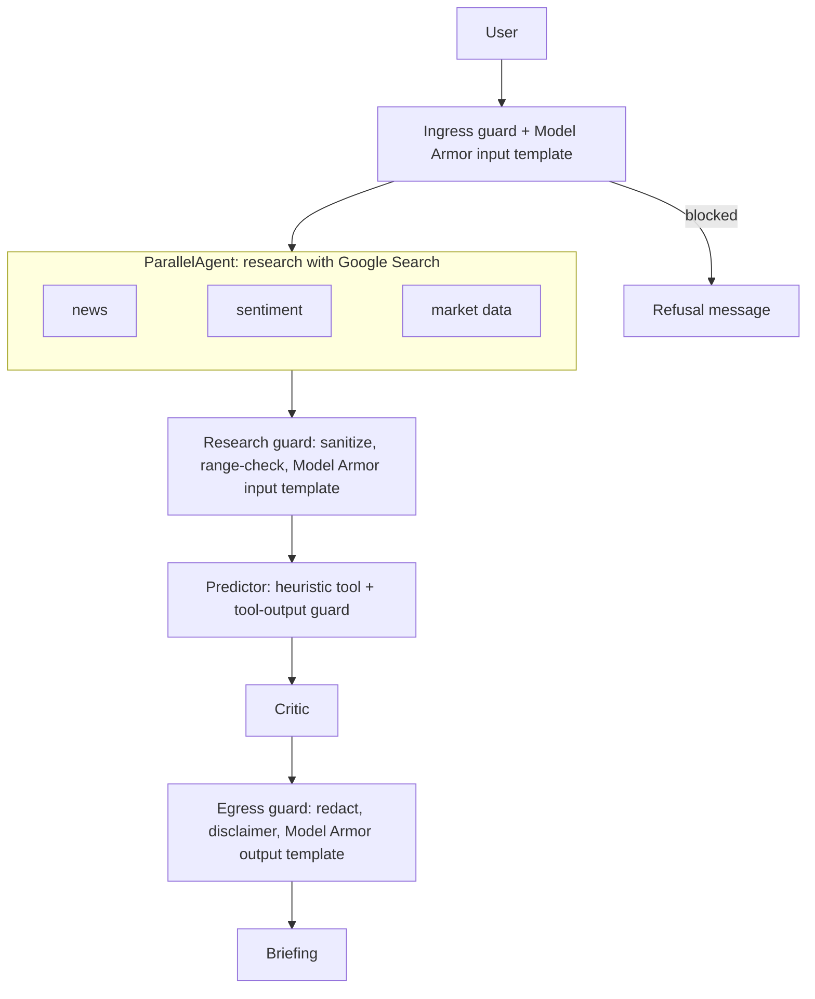

# Hormuz Pulse

Hormuz Pulse is a Google Agent Development Kit (ADK) demo that researches Strait
of Hormuz and oil-market news and produces an illustrative Brent price scenario
for the next 48 hours.

## What makes the scenario

The project does **not** contain a trained or backtested machine-learning model.
`gemini-3.8-flash` (override with the `GEMINI_MODEL` environment variable) is the language model used by the research, input-extraction,
and critic agents; the Brent scenario is calculated by the deterministic Python
function `predict_48h` in `hormuz/agent.py`. It combines fixed momentum,
sentiment, and Hormuz-risk weights. The displayed range comes from a fixed
volatility assumption and is **not** a calibrated 80% confidence interval.
These assumptions have not been validated against historical Brent data. Treat
the result as an educational scenario, not trading advice.

## Multi-agent workflow

The ADK harness is defined in `hormuz/agent.py`:

1. `collect` is a `ParallelAgent`: `news_agent`, `sentiment_agent`, and
   `data_agent` each use Gemini and Google Search; their results are saved under
   the `news`, `sentiment`, and `market` session-state keys.
2. `predictor_agent` runs after collection. Gemini extracts the inputs and calls
   the Python `predict_48h` tool for the base and high-risk scenarios.
3. `critic_agent` runs last, checks the inputs and scenario, and writes the
   briefing.
4. `root_agent` is a `SequentialAgent` that coordinates those three stages.

Gemini does not train a model or independently validate the numerical formula.
The agents depend on search results and language-model extraction, so inputs
can be incomplete or wrong. Missing or invalid numerical inputs are rejected by
the Python tool rather than silently converted into a forecast.

## Guardrails (ingress, tool output, egress)

All checks live in `hormuz/guardrails.py` and run as ADK callbacks. They are
deterministic code, not prompts, and are covered by `tests/test_guardrails.py`.

| Checkpoint | Callback | What it does |
|---|---|---|
| Ingress | `before_agent_callback` on `root_agent` | Blocks empty, over-1000-character, control-character, attachment and instruction-override requests before any model call. |
| Research output (web search) | `after_agent_callback` on the 3 research agents | Treats web-derived text as untrusted: strips control characters, removes injection phrases and secrets, caps length, and appends `VALIDATION FAILED` if `RISK LEVEL`, `SENTIMENT SCORE` (-1..1) or `BRENT PRICE` (10..500) is missing or implausible. The predictor then refuses to compute. |
| Tool output | `after_tool_callback`, `on_tool_error_callback` on `predictor_agent` | Rejects non-finite or implausible results (forecast outside 50%..150% of the input price) and reports invalid inputs to the model instead of crashing the run. |
| Egress | `after_model_callback` on every LLM agent | Redacts API keys, tokens and private keys, caps output length, and appends the not-financial-advice disclaimer to the final briefing if missing. |

### Model Armor (managed layer)

`hormuz/model_armor.py` adds Google Cloud Model Armor on top of the code checks.
It is off until `MODEL_ARMOR_LOCATION` and the template names are set.

| Template | Applied to | Filters |
|---|---|---|
| `hormuz-input` | user prompt and untrusted web research | prompt injection and jailbreak (default `LOW_AND_ABOVE`), sensitive data (basic), malicious URLs, responsible AI (`MEDIUM_AND_ABOVE`) |
| `hormuz-output` | final briefing from the critic | sensitive data, malicious URLs, responsible AI |

Separate input and output templates keep each side tunable and traceable.
Confidence: `HIGH` = fewest false positives, `LOW_AND_ABOVE` = most detections
and most false positives. Tune with `MA_PI_CONFIDENCE` and `MA_RAI_CONFIDENCE`.
If the service errors the request is blocked; set `MODEL_ARMOR_FAIL_OPEN=true`
to allow it instead.

```bash
gcloud services enable modelarmor.googleapis.com --project hormuz-pulse-agent
.venv/bin/python scripts/create_model_armor_templates.py hormuz-pulse-agent us-central1
# then add to .env: MODEL_ARMOR_LOCATION=us-central1
#   MODEL_ARMOR_INPUT_TEMPLATE=hormuz-input  MODEL_ARMOR_OUTPUT_TEMPLATE=hormuz-output
```

The agent's own identity needs `roles/modelarmor.user` (`deploy.sh` grants it to
the Cloud Run service account); the script needs `roles/modelarmor.admin`.
Model Armor has not been exercised against the live service from this repo.

These are best-effort filters: pattern matching cannot catch every prompt
injection or leak, so keep the service private and the runtime service account
limited to `roles/aiplatform.user`.

Network ingress and egress: Cloud Run keeps its default ingress (`all`) but is
protected by IAM authentication unless you set `PUBLIC_SERVICE=true`. Egress is
left open because the agents must reach Vertex AI and Google Search; restricting
it needs a VPC with Cloud NAT and is not configured here.

## Architecture



The pipeline is an ADK `SequentialAgent` in `hormuz/agent.py`. Agents share state
through `output_key` and `{placeholders}`. The forecast is a fixed formula, not
an ML model; Gemini only researches and critiques.

## CI/CD and operations

| Stage | Trigger | What runs |
|---|---|---|
| CI | every pull request and push to `main` | unit tests, attack-corpus regression (`tests/data/attack_corpus.json`), `adk eval` on `evals/guardrails.evalset.json`, secret scan (gitleaks), script syntax checks. No cloud credentials, no model calls. |
| CD | CI passes on `main`, or manual run | keyless Workload Identity Federation, then `deploy.sh` with `SKIP_BOOTSTRAP=true`, then a check that the new revision is ready. Uses the `production` GitHub environment, so you can require manual approval there. |
| Dependencies | weekly | Dependabot for pip and GitHub Actions. |

Separation of duties: the CI deployer service account can deploy Cloud Run
revisions but cannot change IAM or call Vertex AI. The runtime service account
can call Vertex AI and Model Armor but cannot deploy. Admin setup (APIs, runtime
account, Model Armor templates) is a one-time manual step.

One-time setup by a project admin:

```bash
./deploy.sh hormuz-pulse-agent                      # APIs, runtime service account, first deploy
scripts/setup_cicd.sh hormuz-pulse-agent            # keyless GitHub access; prints the variables to set
```

Then add the printed values as GitHub repository variables (no secrets are
needed) and, optionally, add required reviewers to the `production` environment.

Guardrail changes must keep the attack corpus green: add every new attack string
to `tests/data/attack_corpus.json` so it can never regress. Live-model
evaluation (`adk eval` with real forecasts) calls Vertex AI and costs money, so
it is deliberately not part of CI.

Rollback: Cloud Run keeps previous revisions.

```bash
gcloud run revisions list --service hormuz-pulse --region europe-west2
gcloud run services update-traffic hormuz-pulse --region europe-west2 --to-revisions REVISION=100
```

Logs: `gcloud run services logs read hormuz-pulse --region europe-west2`. Model
Armor blocks are logged with the filter names only, never the user's text.

## Local development

Requirements: Python 3.10 or later, [uv](https://docs.astral.sh/uv/getting-started/installation/),
the Google Cloud CLI, and a Google Cloud project with billing enabled. The app
calls Gemini through Vertex AI using your Google identity, so there is no API
key to store.

```bash
export PATH="$HOME/.local/bin:$PATH"
uv venv --python 3.12 .venv
uv pip install --python .venv/bin/python -r hormuz/requirements.txt
cp .env.example .env        # .env is gitignored; edit the project ID if needed
gcloud auth application-default login
set -a; source .env; set +a
.venv/bin/adk web
```

Select `hormuz` in the UI and ask: "Predict Brent for the next 48 hours."

Run the deterministic forecast tests:

```bash
.venv/bin/python -m unittest discover -s tests
```

## Google Cloud Run deployment

Deployment uses Google Cloud Build and the ADK `adk deploy cloud_run` command.
The service is private by default, uses a dedicated Cloud Run service account,
and calls Gemini through Vertex AI with that service account (`roles/aiplatform.user`).
No API key is created, stored, or committed.

### One-time prerequisites

1. Install the [Google Cloud CLI](https://cloud.google.com/sdk/docs/install).
   If installed under `~/google-cloud-sdk`, add it to the current shell:

   ```bash
   export PATH="$HOME/google-cloud-sdk/bin:$PATH"
   export CLOUDSDK_PYTHON="$(pwd)/.venv/bin/python"
   ```

2. Use a Google Cloud project with billing enabled. Sign in and select the
   project:

   ```bash
   export CLOUDSDK_PYTHON="$(pwd)/.venv/bin/python"
   gcloud auth login
   gcloud config set project YOUR_PROJECT_ID
   ```

3. The deploying identity needs permission to enable APIs, deploy Cloud Run,
   use the runtime service account, grant IAM roles, and run Cloud Build.
   Ask the project administrator to grant the least-privilege roles required
   by the organization. ADK's Cloud Run deploy uses Cloud Build; its build
   service account must have `roles/cloudbuild.builds.builder`.

### Deploy

From the project directory:

```bash
./deploy.sh YOUR_PROJECT_ID [REGION]
```

The default region is `europe-west2`; Vertex AI uses the `global` location
(override with `VERTEX_LOCATION`). Cloud Run requires authentication by default.
To make the service public for a demo, explicitly opt in:

```bash
PUBLIC_SERVICE=true ./deploy.sh YOUR_PROJECT_ID [REGION]
```

Public access can incur usage and model costs; use it only when intended. The
ADK web UI is a development interface, not a hardened public product UI.
Cloud Run's default ADK session and artifact services are in-memory, so session
data does not persist across instance restarts or scale-down.

## Production limitations and next steps

Before using this for operational or financial decisions, replace the heuristic
with a model trained and evaluated on timestamped historical Brent, market, and
Hormuz-risk data. Use a chronological holdout/backtest, compare with simple
baselines, document prediction error and calibration, and monitor drift. Use
reliable licensed market data instead of treating web search as a price feed.
Also add durable session storage only if the product needs conversation history.

For incidents and request diagnostics, inspect the Cloud Run service logs in
Cloud Logging.
