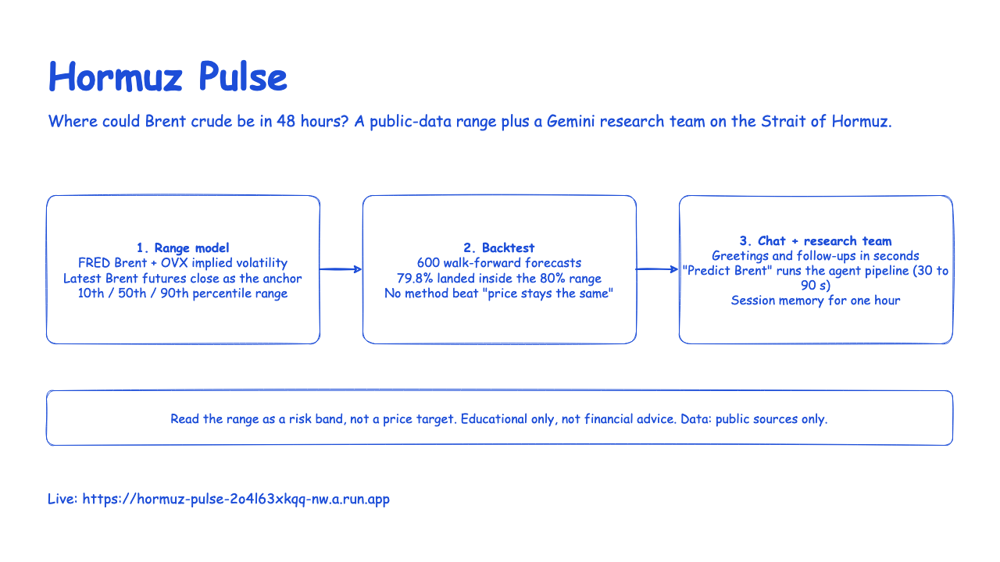
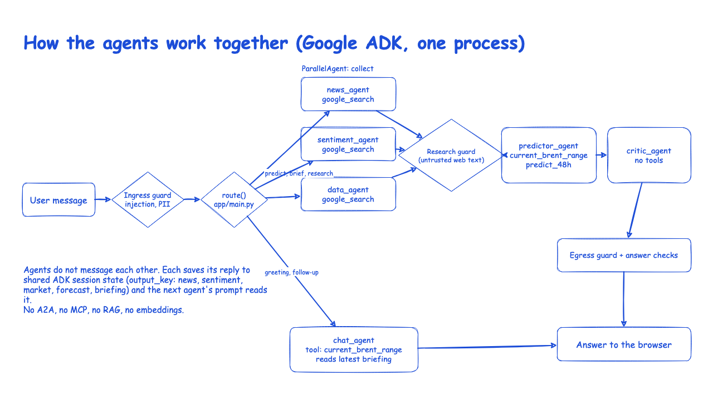
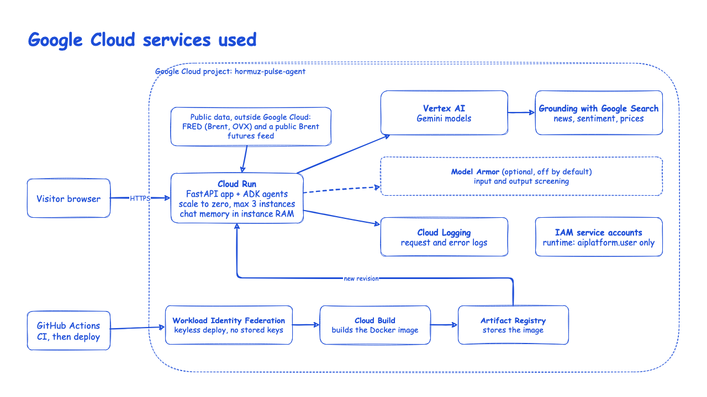
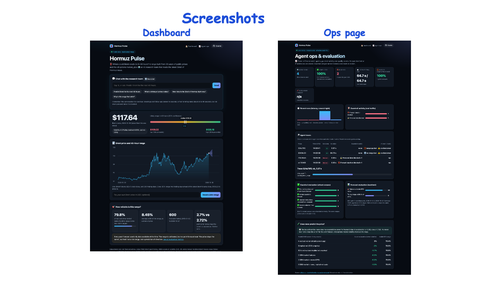
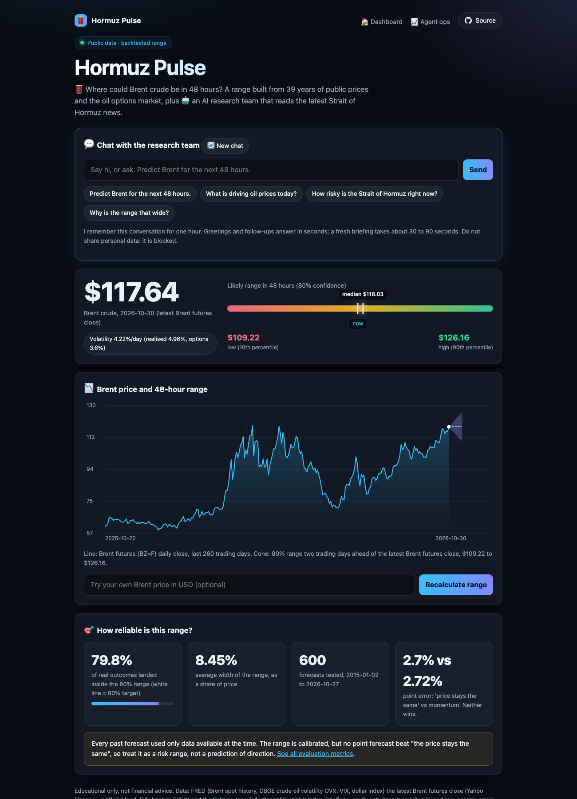
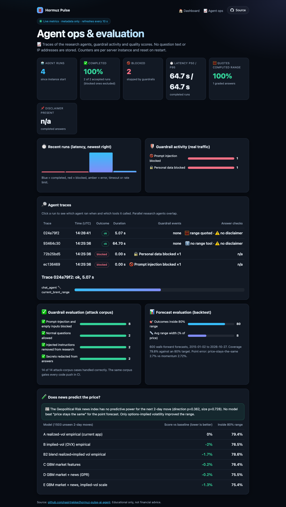
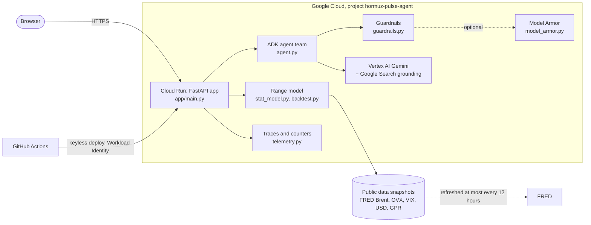
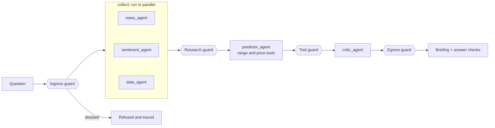
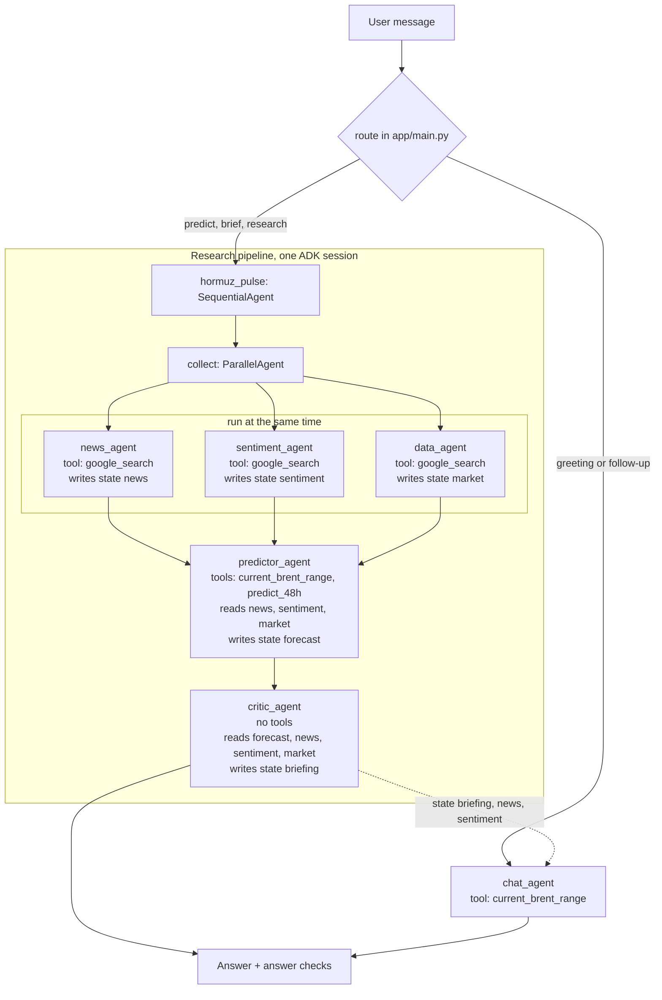
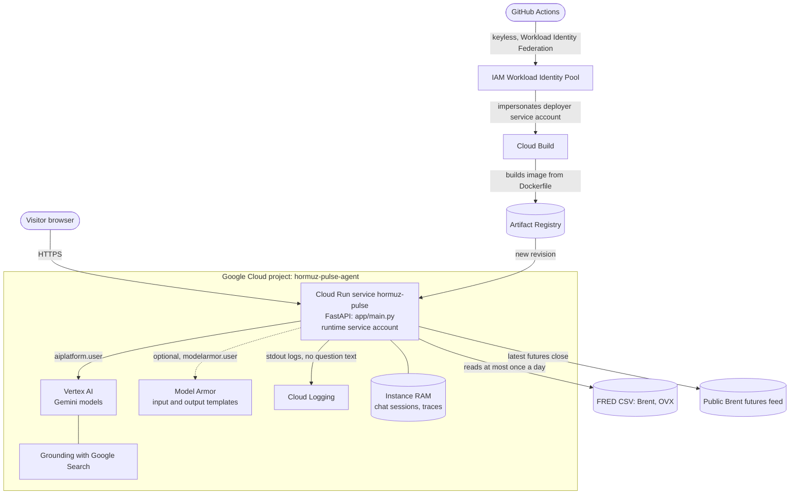

# 🛢️ Hormuz Pulse

[](https://github.com/nasirtrekker/hormuz-pulse-ai-agent/actions/workflows/ci.yml)


🎬 **Demo video:** [docs/demo.mp4](docs/demo.mp4) (regenerate with `python scripts/record_demo.py`)

A web app for forecasters, investors and the public. Open the link and you see
real Brent crude history, a data-driven 48-hour price range with its backtested
reliability, and a live research briefing on the Strait of Hormuz.

### 🌍 Live app: https://hormuz-pulse-2o4l63xkqq-nw.a.run.app

## 🎨 Demo slides (sketch)

Editable source: [docs/demo-slides.drawio](docs/demo-slides.drawio).






## 🖥️ The two pages

### 1. Dashboard (`/`): simple, for everyone



### 2. Research ops (`/ops`): traces and evaluation



## 🧭 How to use it

| Step | What to do | What you get | Cloud cost |
|---|---|---|---|
| 1️⃣ | Open the live link | Latest Brent close, 48-hour low, median and high | 🟢 none |
| 2️⃣ | Type a price in "Try your own Brent price" and click **Recalculate range** | Range recomputed around your price | 🟢 none |
| 3️⃣ | Read "How reliable is this range?" | Backtest: how often real outcomes fell inside the range | 🟢 none |
| 4️⃣ | Chat in **Chat with the research team**: say hi, ask follow-ups, or ask to *predict* (a fresh briefing takes about 30 to 90 seconds) | Chat replies in seconds. A warning appears under an answer only if a check fails (range not quoted, prices far from the range, disclaimer missing); the full check counts are on `/ops` | 🟡 Vertex AI, only when you send a message |
| 5️⃣ | Open **Research ops** | Live traces, latency, guardrail counts, evaluation scores | 🟢 none |

Model and search charges are incurred only when someone sends a chat or briefing
message. Cloud Run, image storage and build charges may also apply, depending on
traffic and deployments. Cloud Run scales to zero when idle.

Read the range as a risk band, not a price target: the backtest shows the band is
calibrated but no method beat "the price stays the same" for direction.

## 💬 Chat, memory and prompts

| Question | Answer |
|---|---|
| Does it remember the conversation? | Yes. The browser sends a random session id; the server keeps an ADK session (messages and the latest briefing) in memory for 1 hour, up to 30 turns. |
| Where is the dialogue saved? | Server RAM only, per Cloud Run instance (session affinity keeps a visitor on one instance). The browser keeps the visible transcript in `sessionStorage`. Nothing is written to a database or disk, and "New chat" clears it. A restart loses it. |
| How does it pick chat or research? | `route()` in `app/main.py`: words like *predict, forecast, brief, research, how risky, what is driving* start the full research pipeline; everything else (greetings, "why is the range so wide?") goes to `chat_agent`. |
| Which Brent price is used? | The range starts from the latest Brent **futures** close (the contract quoted on Google and exchanges), fetched from Yahoo Finance's unofficial public feed, cached 15 minutes, sanity-checked, and falling back to FRED spot if unavailable. The chart shows the same futures closes (FRED Europe Brent spot is the fallback and the source of the 39-year backtest; it runs several dollars higher than futures during supply disruptions). |
| Why does a briefing take longer than chat? | Five agents run across three phases: three search agents in parallel (the slowest sets the time), then the predictor, then the critic. Generation uses low thinking, concise outputs, a 45-second per-model-call timeout and at most one retry for transient provider errors, with a one-second maximum retry delay. The whole pipeline has a 90-second timeout by default; timings are on `/ops`. Chat skips the research pipeline. |
| Where are the system prompts? | In `hormuz/agent.py`: the `instruction=` of each agent (`news_agent`, `sentiment_agent`, `data_agent`, `predictor_agent`, `critic_agent`, `chat_agent`). The user prompt is the message you type; web text is passed to later agents as untrusted data. |
| Is it RAG? Does it use embeddings? | No. There is no vector database and no embedding model. Facts come from Google Search grounding in Gemini and from a Python tool over public FRED data. The research notes and latest briefing are placed in the chat prompt as session state. |

## 🏗️ How the app was built

1. **Data.** Downloaded public series from FRED (Brent, OVX oil volatility, VIX,
   dollar index) and the Caldara-Iacoviello Geopolitical Risk index. Nothing is
   typed in by hand (`hormuz/market_data.py`).
2. **Test what predicts.** `scripts/experiment.py` compared realised volatility,
   options-implied volatility (OVX), gradient-boosted models and a news index on
   1,503 unseen two-day moves. Only OVX helped the range; news and the
   gradient-boosted models did not beat "price stays the same" for direction, so
   they were rejected. This script is offline: no ML model runs in the app.
3. **Range model.** The winner is a blend of realised and implied volatility that
   scales historical quantiles (`hormuz/stat_model.py`), checked by a walk-forward
   backtest (`hormuz/backtest.py`).
4. **Agent team.** Google ADK pipeline: three Gemini research agents in parallel,
   a predictor that calls the range tool, and a critic (`hormuz/agent.py`).
5. **Guardrails.** Deterministic code at input, tool output and answer
   (`hormuz/guardrails.py`), optional Model Armor.
6. **Observability.** Per-request traces and counters with no question text
   (`hormuz/telemetry.py`) feed the `/ops` page.
7. **Web app.** FastAPI serves the API and the two static pages (`app/`).
8. **Ship.** Docker, Cloud Run, GitHub Actions CI, keyless deploy.





| Tool | Used for |
|---|---|
| FastAPI + uvicorn | web server, JSON API, static pages, rate limits, security headers |
| Google ADK | agent team (parallel research, predictor, critic) |
| Gemini on Vertex AI, Google Search grounding | news, sentiment and latest-price research |
| Model Armor (optional) | managed prompt-injection, sensitive-data and responsible-AI filters |
| FRED, Caldara-Iacoviello GPR | public data for the range model and experiments |
| scikit-learn (dev only) | the model comparison in `scripts/experiment.py` |
| Docker, Cloud Run, Cloud Build | container build and hosting |
| GitHub Actions, Workload Identity Federation | CI and keyless deploy |

## 🤝 Agents, tools and how they collaborate



| Agent | Model | Tools | Reads | Writes |
|---|---|---|---|---|
| `news_agent` | Gemini | `google_search` | the user message | state `news` |
| `sentiment_agent` | Gemini | `google_search` | the user message | state `sentiment` |
| `data_agent` | Gemini | `google_search` | the user message | state `market` |
| `predictor_agent` | Gemini | `current_brent_range` (public futures close + range model), `predict_48h` (illustrative overlay) | `news`, `sentiment`, `market` | state `forecast` |
| `critic_agent` | Gemini | none | `forecast`, `news`, `sentiment`, `market` | state `briefing` |
| `chat_agent` | Gemini | `current_brent_range` | `briefing`, `news`, `sentiment` and the conversation | the reply |

**How they collaborate.** All agents run inside one process, orchestrated by Google ADK workflow agents: `ParallelAgent` for the three researchers and `SequentialAgent` for research, predictor, critic. They do not message each other: each agent saves its output to the shared ADK session state (`output_key`) and the next agent's instruction reads it. Guardrail callbacks sit between the stages (`research_guard` after the researchers, `tool_output_guard` after tools, `egress_guard` after every model reply).

**Is it A2A or MCP?** No. There is no Agent2Agent protocol, no MCP server or client, no agent-as-a-tool and no remote agents. Everything is in-process ADK; the only network calls are Gemini on Vertex AI (with Google Search grounding), optional Model Armor, and the public data downloads. Both could be added later (for example exposing `current_brent_range` as an MCP tool, or running the researchers as A2A services), but they are not used today.

**Other Google services used by the agents:** Vertex AI (Gemini), Grounding with Google Search, and optionally Model Armor. No Vertex AI Agent Engine, Vector Search or embeddings.

### How each agent is built

Every agent is an ADK `Agent(...)` in `hormuz/agent.py`. The same few parts make each one:

| Part | What it is | Example |
|---|---|---|
| `model` | The Gemini model on Vertex AI (`GEMINI_MODEL`, set once as `MODEL`) | all six agents share it |
| `instruction` | The system prompt. Placeholders such as `{news}` are filled from the session state when the agent runs | `predictor_agent` is told to call the range tool first and copy its numbers |
| `tools` | What it may call: the built-in `google_search`, or a plain Python function | researchers get `google_search`; predictor and chat get Python functions |
| `output_key` | The state name its reply is saved under, which later agents read | `news`, `sentiment`, `market`, `forecast`, `briefing` |
| callbacks | Guardrail functions from `hormuz/guardrails.py` | `research_guard` on the researchers, `tool_output_guard` on tools, `egress_guard` on every reply |

Build order in the file:

1. **Tools first.** `historical_range_48h` and `current_brent_range` call the range model in `hormuz/stat_model.py`; `predict_48h` is an illustrative overlay. They are ordinary Python functions with type hints and docstrings, which ADK turns into tool definitions for Gemini.
2. **Researchers.** `news_agent`, `sentiment_agent` and `data_agent` each get `google_search` and a prompt asking for a fixed format (`RISK LEVEL`, `SENTIMENT SCORE`, `BRENT PRICE`) so `research_guard` can validate it.
3. **`collect`.** A `ParallelAgent` runs the three researchers at once.
4. **`predictor_agent`.** Reads the three research outputs, calls the range tool and writes `forecast`.
5. **`critic_agent`.** No tools. Writes the final `briefing` and must copy the range from the forecast.
6. **`root_agent`.** A `SequentialAgent` of `collect`, predictor and critic, with `ingress_guard` as its `before_agent_callback`, so a blocked question never reaches a model.
7. **`chat_agent`.** A separate single agent for greetings and follow-ups. It reads the latest briefing and research notes from the session state through optional placeholders, so it can answer without re-running the pipeline.

`app/main.py` wraps `root_agent` or `chat_agent` in an ADK `Runner` with one shared `InMemorySessionService`; the session is what gives the chat its memory.

## ☁️ Which Google Cloud service does what

| Service | Job in this app | When it costs money |
|---|---|---|
| 🏃 **Cloud Run** | Hosts the FastAPI container at the public URL; scales to zero; up to 3 instances, 20 concurrent requests each, session affinity for chat | only while handling requests |
| 🧠 **Vertex AI (Gemini)** | Runs the model behind every agent: research, predictor, critic and chat | only when a visitor sends a message |
| 🔎 **Grounding with Google Search** | Lets the three research agents read current news, sentiment and prices | per grounded request, with Gemini |
| 🛡️ **Model Armor** (optional) | Managed screening of questions and answers for injection and sensitive data, on top of the code guardrails | per screened text; off unless `ENABLE_MODEL_ARMOR=true` |
| 🔨 **Cloud Build** | Builds the Docker image from source during `deploy.sh` | per build |
| 📦 **Artifact Registry** | Stores the built container image | small storage fee |
| 🔑 **IAM service accounts** | The runtime account has only `aiplatform.user` (+ `modelarmor.user`); a separate deployer account is used by CI | free |
| 🪪 **Workload Identity Federation** | Lets GitHub Actions deploy with no stored keys | free |
| 📜 **Cloud Logging** (automatic) | Collects request and error logs from Cloud Run; logs hold no question text | free tier, then per GB |

Chat memory is held in the Cloud Run instance's RAM, so no database is used.

### Google Cloud architecture



| Arrow | Code that triggers it |
|---|---|
| Browser to Cloud Run | `app/main.py` serves `/`, `/ops` and the `/api/*` endpoints |
| Cloud Run to Vertex AI | ADK `Runner` in `app/main.py` runs the agents in `hormuz/agent.py`; credentials come from the runtime service account, no key files |
| Vertex AI to Google Search | `google_search` tool on the three research agents in `hormuz/agent.py` |
| Cloud Run to Model Armor | `hormuz/model_armor.py`, called by `hormuz/guardrails.py` when `ENABLE_MODEL_ARMOR=true` |
| Cloud Run to FRED and futures feed | `hormuz/market_data.py` and `_Data.refresh_if_stale` in `app/main.py` |
| GitHub to Cloud Build to Cloud Run | `.github/workflows/deploy.yml` runs `deploy.sh`, which calls `gcloud run deploy --source` |

## 🔬 Code walkthrough: what happens to one message

| Step | Code | What it does |
|---|---|---|
| 1 | `brief()` in `app/main.py` | receives the message and session id, starts a trace (`telemetry.begin`) |
| 2 | `guardrails.check_input` | blocks injection phrases, personal data, control characters and over-long input before any model call |
| 3 | `limiter.allow` | per-IP and daily limits; chat and briefings have separate allowances |
| 4 | `route()` | chooses `chat_agent` or the research pipeline from the wording |
| 5 | `_ensure_session`, `_run_agents` | finds or creates the visitor's ADK session (the memory) and streams agent events into the trace |
| 6 | `news_agent`, `sentiment_agent`, `data_agent` | search the web in parallel; `research_guard` cleans and validates what they return |
| 7 | `predictor_agent` | calls `current_brent_range` (futures close plus `stat_model.forecast_blend`) and `predict_48h` |
| 8 | `critic_agent` or `chat_agent` | writes the answer, copying the range from the tool; `egress_guard` redacts secrets and adds the disclaimer |
| 9 | `telemetry.check_answer` | checks the answer quotes the computed range, flags off-range prices, checks the disclaimer |
| 10 | `/ops` (`ops.js`) | reads `/api/ops` and `/api/traces` and draws the panels |

## 🗂️ What each file does

| File | Job |
|---|---|
| `app/main.py` | FastAPI service: endpoints, router, chat sessions, data refresh, backtest cache, rate limiting, traces |
| `app/static/index.html`, `app.js`, `style.css` | the dashboard (canvas chart, chat box, warnings when an answer check fails), no external libraries |
| `app/static/ops.html`, `ops.js` | the ops page: stat panels, latency bars, guardrail counts, per-agent trace timeline, evaluation |
| `hormuz/market_data.py` | loads and refreshes Brent and OVX series from FRED |
| `hormuz/stat_model.py` | computes the 48-hour range from standardised historical returns |
| `hormuz/backtest.py` | walk-forward test of that range |
| `hormuz/agent.py` | ADK pipeline and the `historical_range_48h` tool |
| `hormuz/guardrails.py`, `hormuz/model_armor.py` | ingress, tool-output and egress checks, PII blocking |
| `hormuz/telemetry.py` | in-memory traces and counters (metadata only) and the answer checks |
| `hormuz/quality.py` | runs the guardrails against the attack corpus for the live report |
| `hormuz/data/attack_corpus.json` | 14 attack and normal cases used by tests, CI and `/ops` |
| `scripts/experiment.py` | compares models and writes `hormuz/data/experiment_results.json` |
| `deploy.sh`, `Dockerfile`, `scripts/setup_cicd.sh`, `.github/workflows/` | deployment and CI/CD |
| `tests/`, `evals/` | unit tests, attack-corpus regression, ADK eval |

| Endpoint | Returns |
|---|---|
| `GET /` and `GET /ops` | the dashboard and the ops page |
| `GET /api/history`, `/api/forecast?price=`, `/api/backtest` | prices, range, backtest |
| `GET /api/evidence` | model comparison and news verdict |
| `GET /api/quality` | live guardrail evaluation against the attack corpus |
| `GET /api/ops`, `/api/traces` | summary metrics and recent traces |
| `POST /api/brief` | agent briefing with `trace_id` and `checks` |

Public use is protected by per-IP and daily briefing limits
(`BRIEFS_PER_IP_PER_HOUR`, `BRIEFS_PER_DAY`, per instance), the guardrails,
an application timeout of 90 s by default and a Cloud Run request timeout of
300 s. The deployment caps Cloud Run at 3 instances.

## 🛡️ Guardrails and answer checks

| Risk | Control | Where | Status |
|---|---|---|---|
| 🚫 Prompt injection in the question | override phrases, control characters and attachments blocked before any model call | `check_input` | 🟢 8 of 8 corpus cases |
| 🕸️ Injection hidden in web results | web text treated as untrusted: phrases removed, length capped, format validated | `research_guard` | 🟢 2 of 2 |
| 🔒 Personal data | emails and card-like numbers blocked; questions and IPs are never stored | `check_input`, `telemetry.py` | 🟢 included in the 8 |
| 🔑 Secret leakage | API keys and tokens redacted from every model output | `egress_guard` | 🟢 2 of 2 |
| 🧮 Wrong or invented prices | the range is computed by code and the prompt tells the model to copy it; each answer is then checked for quoting it, for off-range dollar figures and for the disclaimer | `telemetry.check_answer` | 🟡 flags problems, does not prevent them |
| 🧰 Bad tool output | non-finite or implausible results rejected | `tool_output_guard` | 🟢 unit tested |

The input and output filters are deterministic code, not prompts. The attack corpus is small (14 cases) and runs in CI and on `/ops`; passing it does not prove the guardrails stop every attack. The answer checks only look at the computed range, price figures and the disclaimer; they cannot verify the news or sentiment text, so sources must still be read. Model Armor is off unless enabled.

## ✅ CI: what runs when you push

Open the **Actions** tab. The `CI` workflow (`.github/workflows/ci.yml`) runs on
every push to `main` and every pull request, with no cloud credentials and no
model calls:

| Job and step | What it checks | Result |
|---|---|---|
| test: unit tests | 64 tests: range model, backtest, API, telemetry, guardrails, agent wiring and bounded model requests | ✅ |
| test: attack corpus | known injection, PII and secret strings stay blocked or redacted | ✅ |
| test: `adk eval` | ADK evaluation in `evals/guardrails.evalset.json` | ✅ |
| test: build inputs, script syntax | Dockerfile and requirements exist, shell scripts parse | ✅ |
| secrets: gitleaks | no credentials in history (`.gitleaks.toml` allows only the fake test keys) | ✅ |

The badge at the top shows the real status of the latest run. Deploys are separate
(`deploy.yml`): they run after CI passes on `main`, or manually, and are skipped until the `GCP_WORKLOAD_IDENTITY_PROVIDER` repository variable is set (see CI/CD and operations).

## 📈 Evaluation metrics

| Metric | Value | Where to see it |
|---|---|---|
| Range coverage vs 80% target | 79.8% 🟢 | dashboard and `/ops` |
| Average range width | 8.45% of price | dashboard |
| Point error: no change vs momentum | 2.70% vs 2.72% 🟡 | dashboard |
| Guardrail corpus | 14 of 14 🟢 | `/ops` |
| News (GPR) predictive power | none, p = 0.36 (direction) and 0.73 (size) 🔴 | `/ops` |
| Agent latency, completion, range-quoted rate | live | `/ops` |

Traces are held in memory per server instance and reset on restart.

## Quick start

```bash
uv venv --python 3.12 .venv && uv pip install -r requirements.txt -r requirements-dev.txt
cp .env.example .env            # set GOOGLE_CLOUD_PROJECT
.venv/bin/uvicorn app.main:app --port 8080     # open http://localhost:8080
.venv/bin/python -m unittest discover -s tests
```

The dashboard needs no credentials. For the briefing run
`gcloud auth application-default login` and enable `aiplatform.googleapis.com`.
Deploy with `PUBLIC_SERVICE=true ./deploy.sh <project-id>`.

### Test, deploy and push in one command

Run from the repository root after a one-time `gcloud auth login`. It stops at the first failure:

```bash
.venv/bin/python -W ignore -m unittest discover -s tests \
 && CLOUDSDK_PYTHON="$PWD/.venv/bin/python" PATH="$HOME/google-cloud-sdk/bin:$PATH" PUBLIC_SERVICE=true ./deploy.sh hormuz-pulse-agent \
 && git add -A && (git diff --cached --quiet || git commit -m "Update") && git push
```

The Google Cloud services this deploys to, and what each one does, are in
[Which Google Cloud service does what](#️-which-google-cloud-service-does-what) and the
[architecture diagram](#google-cloud-architecture) above.

## Guardrail callbacks in detail

All checks live in `hormuz/guardrails.py` and run as ADK callbacks. They are
deterministic code, not prompts, and are covered by `tests/test_guardrails.py`.

| Checkpoint | Callback | What it does |
|---|---|---|
| Ingress | `before_agent_callback` on `root_agent` | Blocks empty, over-1000-character, control-character, attachment and instruction-override requests before any model call. |
| Research output (web search) | `after_agent_callback` on the 3 research agents | Treats web-derived text as untrusted: strips control characters, removes injection phrases and secrets, caps length, and appends `VALIDATION FAILED` if required fields are missing or implausible. The predictor skips tool calls when the news risk or sentiment score fails validation. If market-price fields fail validation, it can still calculate the statistical range and uses a zero five-day change for the illustrative overlay. |
| Tool output | `after_tool_callback`, `on_tool_error_callback` on `predictor_agent` | Rejects non-finite or implausible results (forecast outside 50%..150% of the input price) and reports invalid inputs to the model instead of crashing the run. |
| Egress | `after_model_callback` on every LLM agent | Redacts API keys, tokens and private keys, caps output length, and appends the not-financial-advice disclaimer to the final briefing if missing. |

### Model Armor (managed layer)

`hormuz/model_armor.py` adds Google Cloud Model Armor on top of the code checks.
It is off until `MODEL_ARMOR_LOCATION` and the template names are set.

| Template | Applied to | Filters |
|---|---|---|
| `hormuz-input` | user prompt and untrusted web research | prompt injection and jailbreak (default `LOW_AND_ABOVE`), sensitive data (basic), malicious URLs, responsible AI (`MEDIUM_AND_ABOVE`) |
| `hormuz-output` | final briefing from the critic | sensitive data, malicious URLs, responsible AI |

Separate input and output templates keep each side tunable and traceable.
Confidence: `HIGH` = fewest false positives, `LOW_AND_ABOVE` = most detections
and most false positives. Tune with `MA_PI_CONFIDENCE` and `MA_RAI_CONFIDENCE`.
If the service errors the request is blocked; set `MODEL_ARMOR_FAIL_OPEN=true`
to allow it instead.

```bash
gcloud services enable modelarmor.googleapis.com --project hormuz-pulse-agent
.venv/bin/python scripts/create_model_armor_templates.py hormuz-pulse-agent us-central1
# then add to .env: MODEL_ARMOR_LOCATION=us-central1
#   MODEL_ARMOR_INPUT_TEMPLATE=hormuz-input  MODEL_ARMOR_OUTPUT_TEMPLATE=hormuz-output
```

The agent's own identity needs `roles/modelarmor.user` (`deploy.sh` grants it to
the Cloud Run service account); the script needs `roles/modelarmor.admin`.
Model Armor has not been exercised against the live service from this repo.

These are best-effort filters: pattern matching cannot catch every prompt
injection or leak, so keep the service private and the runtime service account
limited to `roles/aiplatform.user`.

Network ingress and egress: Cloud Run keeps its default ingress (`all`) but is
protected by IAM authentication unless you set `PUBLIC_SERVICE=true`. Egress is
left open because the agents must reach Vertex AI and Google Search; restricting
it needs a VPC with Cloud NAT and is not configured here.

## Prediction: data and method

All market data is public and no API key is needed.

| Item | Source | Used for |
|---|---|---|
| Brent daily spot since 1987 | FRED `DCOILBRENTEU` | the 48-hour range |
| Crude oil implied volatility (OVX), from 2007 | FRED `OVXCLS` | the 48-hour range (options-market expectation) |
| VIX, USD index | FRED `VIXCLS`, `DTWEXBGS` | experiment features only |
| Geopolitical Risk Index, daily, from newspaper coverage, 1985 on | Caldara and Iacoviello (matteoiacoviello.com/gpr.htm) | experiment feature only |
| Latest Brent futures close, last 2 years | Yahoo Finance public chart endpoint (unofficial, no SLA), cached 15 min | the starting price and the chart; FRED is the fallback |
| News and sentiment | Gemini with Google Search grounding, at request time | the narrative only, not the numbers |

Snapshots are in `hormuz/data/`; refresh Brent and OVX with `python -m hormuz.market_data`.

## How the range is computed

`hormuz/stat_model.py` (`forecast_blend`): for each past day it takes the 2-day
log return divided by a volatility scale, where the scale is the geometric mean of
20-day realised volatility and the OVX-implied daily volatility. The 10th/50th/90th
percentiles of those standardised returns come from the data (no normal assumption)
and are scaled by today's blended volatility around the live price. The tool
`historical_range_48h` in `hormuz/agent.py` exposes it to the predictor agent.

## Evidence (`python scripts/experiment.py`, walk-forward, 1,503 unseen 2-day moves, 2015 to 2026-10-23)

Quantiles are refit yearly using only past data and scored with pinball loss.

| Model | Score vs realised-vol model | 80% range coverage |
|---|---|---|
| Realised-vol empirical | baseline | 79.4% |
| Implied-vol (OVX) empirical | -2.0% | 76.5% |
| Blend of both (used) | -1.7% | 78.6% |
| Gradient boosting, market features | -0.2% | 76.4% |
| Gradient boosting, market + news (GPR) | -0.2% | 75.5% |
| Gradient boosting, market + news, implied-vol scale | -1.3% | 75.4% |

Findings, stated plainly:
- The range is calibrated, and options-implied volatility improves it modestly.
- The Geopolitical Risk news index showed no predictive power for the next 2-day
  direction (Spearman p from 0.36 to 0.98 across its three variants) and added nothing in the models.
- No model meaningfully beat "price stays the same" as a point forecast (median error 2.79% for the range models' median vs 2.80% for no change). The app therefore shows a
  range, not a price target.
- LLM sentiment cannot be backtested historically, so it is a labelled narrative and
  scenario input (`predict_48h`), not a validated predictor.
- A crisis can move prices beyond anything in the history.

The checked-in results cover 1,503 test points from 2015 through 2026-10-23.
They are reproducible from the bundled data with `python scripts/experiment.py`.
The same results are served at `/api/evidence` and shown in the dashboard.

### Fact-check notes

Checked against the implementation, tests and bundled result files on
2026-10-31. The backtest and experiment numbers above describe historical
samples, not a guarantee of future performance. The live dashboard recomputes
its walk-forward backtest from the currently loaded data, so its values can
differ from the separate, checked-in experiment results.

## CI/CD and operations

| Stage | Trigger | What runs |
|---|---|---|
| CI | every pull request and push to `main` | unit tests, attack-corpus regression (`hormuz/data/attack_corpus.json`), `adk eval` on `evals/guardrails.evalset.json`, secret scan (gitleaks), script syntax checks. No cloud credentials, no model calls. |
| CD | CI passes on `main`, or manual run | keyless Workload Identity Federation, then `deploy.sh` with `SKIP_BOOTSTRAP=true`, then a check that the new revision is ready. Uses the `production` GitHub environment, so you can require manual approval there. Skipped until the `GCP_WORKLOAD_IDENTITY_PROVIDER` repository variable exists. |
| Dependencies | weekly | Dependabot for pip and GitHub Actions. |

Separation of duties: the CI deployer service account can deploy Cloud Run
revisions but cannot change IAM or call Vertex AI. The runtime service account
can call Vertex AI and Model Armor but cannot deploy. Admin setup (APIs, runtime
account, Model Armor templates) is a one-time manual step.

One-time setup by a project admin:

```bash
./deploy.sh hormuz-pulse-agent                      # APIs, runtime service account, first deploy
scripts/setup_cicd.sh hormuz-pulse-agent            # keyless GitHub access; prints the variables to set
```

Then add the printed values as GitHub repository variables (no secrets are
needed) and, optionally, add required reviewers to the `production` environment.

Guardrail changes must keep the attack corpus green: add every new attack string
to `hormuz/data/attack_corpus.json` so it can never regress. Live-model
evaluation (`adk eval` with real forecasts) calls Vertex AI and costs money, so
it is deliberately not part of CI.

Rollback: Cloud Run keeps previous revisions.

```bash
gcloud run revisions list --service hormuz-pulse --region europe-west2
gcloud run services update-traffic hormuz-pulse --region europe-west2 --to-revisions REVISION=100
```

Logs: `gcloud run services logs read hormuz-pulse --region europe-west2`. Model
Armor blocks are logged with the filter names only, never the user's text.

## Local development

Requirements: Python 3.10 or later, [uv](https://docs.astral.sh/uv/getting-started/installation/),
the Google Cloud CLI, and a Google Cloud project with billing enabled. The app
calls Gemini through Vertex AI using your Google identity, so there is no API
key to store.

```bash
export PATH="$HOME/.local/bin:$PATH"
uv venv --python 3.12 .venv
uv pip install --python .venv/bin/python -r requirements.txt
cp .env.example .env        # .env is gitignored; edit the project ID if needed
gcloud auth application-default login
set -a; source .env; set +a
.venv/bin/uvicorn app.main:app --port 8080     # the web app: http://localhost:8080
```

The dashboard works immediately. The briefing button needs the Vertex AI login
above. For the ADK developer UI run `.venv/bin/adk web` and pick `hormuz`.

Run the tests (API, guardrails, model, attack corpus):

```bash
uv pip install --python .venv/bin/python -r requirements-dev.txt
.venv/bin/python -W ignore -m unittest discover -s tests
```

## Google Cloud Run deployment

Deployment builds the repository `Dockerfile` with Cloud Build (`gcloud run deploy --source`).
The service is private by default, uses a dedicated Cloud Run service account,
and calls Gemini through Vertex AI with that service account (`roles/aiplatform.user`).
No API key is created, stored, or committed.

### One-time prerequisites

1. Install the [Google Cloud CLI](https://cloud.google.com/sdk/docs/install).
   If installed under `~/google-cloud-sdk`, add it to the current shell:

   ```bash
   export PATH="$HOME/google-cloud-sdk/bin:$PATH"
   export CLOUDSDK_PYTHON="$(pwd)/.venv/bin/python"
   ```

2. Use a Google Cloud project with billing enabled. Sign in and select the
   project:

   ```bash
   export CLOUDSDK_PYTHON="$(pwd)/.venv/bin/python"
   gcloud auth login
   gcloud config set project YOUR_PROJECT_ID
   ```

3. The deploying identity needs permission to enable APIs, deploy Cloud Run,
   use the runtime service account, grant IAM roles, and run Cloud Build.
   Ask the project administrator to grant the least-privilege roles required
   by the organization. Cloud Build builds the container; its build
   service account must have `roles/cloudbuild.builds.builder`.

### Deploy

From the project directory:

```bash
./deploy.sh YOUR_PROJECT_ID [REGION]
```

The default region is `europe-west2`; Vertex AI uses the `global` location
(override with `VERTEX_LOCATION`). Cloud Run requires authentication by default.
To make the service public for a demo, explicitly opt in:

```bash
PUBLIC_SERVICE=true ./deploy.sh YOUR_PROJECT_ID [REGION]
```

Public access can incur Vertex AI costs, billed to the project: each briefing runs
several Gemini calls with Google Search. The limits above cap this but are per
instance. Chat sessions are held in memory for up to an hour.
Model Armor is optional: create the templates first, then deploy with
`ENABLE_MODEL_ARMOR=true`, otherwise it fails closed and blocks every request.

## Production limitations and next steps

The 48-hour range is backtested, but the price series is daily spot data that
FRED updates with a delay, and the starting price comes from an unofficial public
futures feed, not a licensed one. Before using this for financial decisions: add a licensed
real-time price source, test whether news-volume features (for example GDELT)
improve the backtest, and monitor calibration over time. Limits are per instance;
use Cloud Armor or a shared store if abuse becomes a problem.

For incidents and request diagnostics, inspect the Cloud Run service logs in
Cloud Logging.
