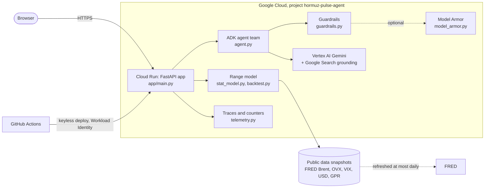
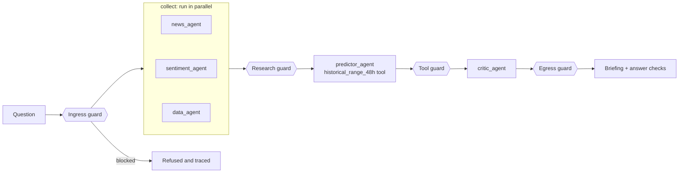
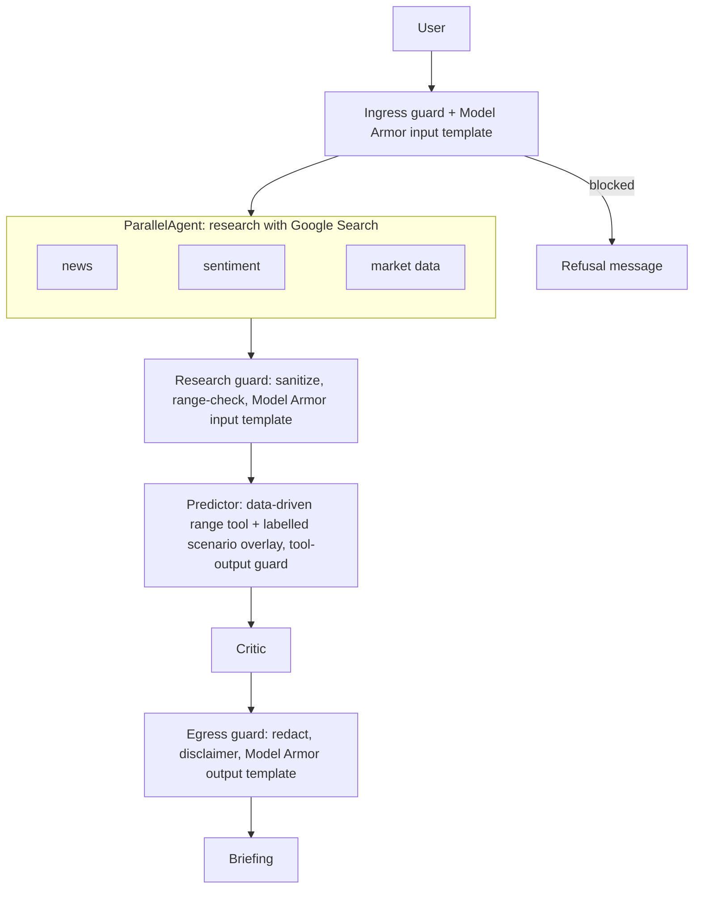

# 🛢️ Hormuz Pulse

[](https://github.com/nasirtrekker/hormuz-pulse-ai-agent/actions/workflows/ci.yml)


A web app for forecasters, investors and the public. Open the link and you see
real Brent crude history, a data-driven 48-hour price range with its backtested
reliability, and a box that runs a team of Gemini research agents (Google ADK)
for a live briefing on the Strait of Hormuz.

### 🌍 Live app: https://hormuz-pulse-2o4l63xkqq-nw.a.run.app

Built by **Nasir Uddin** ([@nasirtrekker](https://github.com/nasirtrekker)).

## 🖥️ The two pages

### 1. Dashboard (`/`): simple, for everyone


### 2. Agent ops (`/ops`): a Grafana-style page for traces and evaluation


## 🧭 How to use it

| Step | What to do | What you get | Cloud cost |
|---|---|---|---|
| 1️⃣ | Open the live link | Latest Brent close, 48-hour low, median and high | 🟢 none |
| 2️⃣ | Type a price in "Try your own Brent price" and click **Recalculate range** | Range recomputed around your price | 🟢 none |
| 3️⃣ | Read "How reliable is this range?" | Backtest: how often real outcomes fell inside the range | 🟢 none |
| 4️⃣ | Type a question in **Ask the research team**, click **Ask** (1 to 3 minutes) | A briefing from the agents plus answer checks (guardrails passed, quotes the computed range, disclaimer) | 🟡 Vertex AI, only when clicked |
| 5️⃣ | Open **Agent ops** | Live traces, latency, guardrail counts, evaluation scores | 🟢 none |

Cloud charges happen only when someone clicks **Ask**. Cloud Run scales to zero
when idle.

Read the range as a risk band, not a price target: the backtest shows the band is
calibrated but no method beat "the price stays the same" for direction.

## 🏗️ How the app was built

1. **Data.** Downloaded public series from FRED (Brent, OVX oil volatility, VIX,
   dollar index) and the Caldara-Iacoviello Geopolitical Risk index. Nothing is
   typed in by hand (`hormuz/market_data.py`).
2. **Test what predicts.** `scripts/experiment.py` compared realised volatility,
   options-implied volatility (OVX), gradient-boosted models and a news index on
   1,503 unseen two-day moves. Only OVX helped the range; news and ML did not
   beat "price stays the same" for direction.
3. **Range model.** The winner is a blend of realised and implied volatility that
   scales historical quantiles (`hormuz/stat_model.py`), checked by a walk-forward
   backtest (`hormuz/backtest.py`).
4. **Agent team.** Google ADK pipeline: three Gemini research agents in parallel,
   a predictor that calls the range tool, and a critic (`hormuz/agent.py`).
5. **Guardrails.** Deterministic code at input, tool output and answer
   (`hormuz/guardrails.py`), optional Model Armor.
6. **Observability.** Per-request traces and counters with no question text
   (`hormuz/telemetry.py`) feed the `/ops` page.
7. **Web app.** FastAPI serves the API and the two static pages (`app/`).
8. **Ship.** Docker, Cloud Run, GitHub Actions CI, keyless deploy.





| Tool | Used for |
|---|---|
| FastAPI + uvicorn | web server, JSON API, static pages, rate limits, security headers |
| Google ADK | agent team (parallel research, predictor, critic) |
| Gemini on Vertex AI, Google Search grounding | news, sentiment and latest-price research |
| Model Armor (optional) | managed prompt-injection, sensitive-data and responsible-AI filters |
| FRED, Caldara-Iacoviello GPR | public data for the range model and experiments |
| scikit-learn (dev only) | the model comparison in `scripts/experiment.py` |
| Docker, Cloud Run, Cloud Build | container build and hosting |
| GitHub Actions, Workload Identity Federation | CI and keyless deploy |

## 🗂️ What each file does

| File | Job |
|---|---|
| `app/main.py` | FastAPI service: endpoints, data refresh, backtest cache, rate limiting, traces |
| `app/static/index.html`, `app.js`, `style.css` | the dashboard (canvas chart, ask box, answer checks), no external libraries |
| `app/static/ops.html`, `ops.js` | the Grafana-style ops page: stat panels, latency bars, guardrail counts, trace Gantt, evaluation |
| `hormuz/market_data.py` | loads and refreshes Brent and OVX series from FRED |
| `hormuz/stat_model.py` | computes the 48-hour range from standardised historical returns |
| `hormuz/backtest.py` | walk-forward test of that range |
| `hormuz/agent.py` | ADK pipeline and the `historical_range_48h` tool |
| `hormuz/guardrails.py`, `hormuz/model_armor.py` | ingress, tool-output and egress checks, PII blocking |
| `hormuz/telemetry.py` | in-memory traces and counters (metadata only) and the answer checks |
| `hormuz/quality.py` | runs the guardrails against the attack corpus for the live report |
| `hormuz/data/attack_corpus.json` | 14 attack and normal cases used by tests, CI and `/ops` |
| `scripts/experiment.py` | compares models and writes `hormuz/data/experiment_results.json` |
| `deploy.sh`, `Dockerfile`, `scripts/setup_cicd.sh`, `.github/workflows/` | deployment and CI/CD |
| `tests/`, `evals/` | unit tests, attack-corpus regression, ADK eval |

| Endpoint | Returns |
|---|---|
| `GET /` and `GET /ops` | the dashboard and the ops page |
| `GET /api/history`, `/api/forecast?price=`, `/api/backtest` | prices, range, backtest |
| `GET /api/evidence` | model comparison and news verdict |
| `GET /api/quality` | live guardrail evaluation against the attack corpus |
| `GET /api/ops`, `/api/traces` | summary metrics and recent traces |
| `POST /api/brief` | agent briefing with `trace_id` and `checks` |

Public use is protected by per-IP and daily briefing limits
(`BRIEFS_PER_IP_PER_HOUR`, `BRIEFS_PER_DAY`, per instance), the guardrails, a
300 s timeout and at most 3 instances.

## 🛡️ Guardrails: injection, privacy, no hallucination

| Risk | Control | Where | Status |
|---|---|---|---|
| 🚫 Prompt injection in the question | override phrases, control characters and attachments blocked before any model call | `check_input` | 🟢 8 of 8 corpus cases |
| 🕸️ Injection hidden in web results | web text treated as untrusted: phrases removed, length capped, format validated | `research_guard` | 🟢 2 of 2 |
| 🔒 Personal data | emails and card-like numbers blocked; questions and IPs are never stored | `check_input`, `telemetry.py` | 🟢 included in the 8 |
| 🔑 Secret leakage | API keys and tokens redacted from every model output | `egress_guard` | 🟢 2 of 2 |
| 🧮 Hallucinated numbers | the range comes from code, not the model; each answer is checked for quoting that range, for off-range dollar figures and for the disclaimer | `telemetry.check_answer` | 🟡 reported per answer |
| 🧰 Bad tool output | non-finite or implausible results rejected | `tool_output_guard` | 🟢 unit tested |

The checks are deterministic code, not prompts. The attack corpus runs in CI on
every push and live on `/ops`. The answer checks reduce hallucination risk but
cannot prove every sentence in a briefing is true: sources must still be read.

## ✅ CI: what runs when you push

Open the **Actions** tab. The `CI` workflow (`.github/workflows/ci.yml`) runs on
every push to `main` and every pull request, with no cloud credentials and no
model calls:

| Job and step | What it checks | Result |
|---|---|---|
| test: unit tests | 57 tests: range model, backtest, API, telemetry, guardrails, agent wiring | ✅ |
| test: attack corpus | known injection, PII and secret strings stay blocked or redacted | ✅ |
| test: `adk eval` | ADK evaluation in `evals/guardrails.evalset.json` | ✅ |
| test: build inputs, script syntax | Dockerfile and requirements exist, shell scripts parse | ✅ |
| secrets: gitleaks | no credentials in history (`.gitleaks.toml` allows only the fake test keys) | ✅ |

The badge at the top shows the real status of the latest run. Deploys are separate
(`deploy.yml`, manual, after CI).

## 📈 Evaluation metrics

| Metric | Value | Where to see it |
|---|---|---|
| Range coverage vs 80% target | 79.8% 🟢 | dashboard and `/ops` |
| Average range width | 8.45% of price | dashboard |
| Point error: no change vs momentum | 2.70% vs 2.72% 🟡 | dashboard |
| Guardrail corpus | 14 of 14 🟢 | `/ops` |
| News (GPR) predictive power | none, p = 0.36 and 0.73 🔴 | `/ops` |
| Agent latency, completion, range-quoted rate | live | `/ops` |

Traces are held in memory per server instance and reset on restart.

## Quick start

```bash
uv venv --python 3.12 .venv && uv pip install -r requirements.txt -r requirements-dev.txt
cp .env.example .env            # set GOOGLE_CLOUD_PROJECT
.venv/bin/uvicorn app.main:app --port 8080     # open http://localhost:8080
.venv/bin/python -m unittest discover -s tests
```

The dashboard needs no credentials. For the briefing run
`gcloud auth application-default login` and enable `aiplatform.googleapis.com`.
Deploy with `PUBLIC_SERVICE=true ./deploy.sh <project-id>`.

## Multi-agent workflow

The ADK harness is defined in `hormuz/agent.py`:

1. `collect` is a `ParallelAgent`: `news_agent`, `sentiment_agent`, and
   `data_agent` each use Gemini and Google Search; their results are saved under
   the `news`, `sentiment`, and `market` session-state keys.
2. `predictor_agent` runs after collection. Gemini extracts the inputs and calls
   the Python `predict_48h` tool for the base and high-risk scenarios.
3. `critic_agent` runs last, checks the inputs and scenario, and writes the
   briefing.
4. `root_agent` is a `SequentialAgent` that coordinates those three stages.

Gemini does not train a model or independently validate the numerical formula.
The agents depend on search results and language-model extraction, so inputs
can be incomplete or wrong. Missing or invalid numerical inputs are rejected by
the Python tool rather than silently converted into a forecast.

## Guardrails (ingress, tool output, egress)

All checks live in `hormuz/guardrails.py` and run as ADK callbacks. They are
deterministic code, not prompts, and are covered by `tests/test_guardrails.py`.

| Checkpoint | Callback | What it does |
|---|---|---|
| Ingress | `before_agent_callback` on `root_agent` | Blocks empty, over-1000-character, control-character, attachment and instruction-override requests before any model call. |
| Research output (web search) | `after_agent_callback` on the 3 research agents | Treats web-derived text as untrusted: strips control characters, removes injection phrases and secrets, caps length, and appends `VALIDATION FAILED` if `RISK LEVEL`, `SENTIMENT SCORE` (-1..1) or `BRENT PRICE` (10..500) is missing or implausible. The predictor then refuses to compute. |
| Tool output | `after_tool_callback`, `on_tool_error_callback` on `predictor_agent` | Rejects non-finite or implausible results (forecast outside 50%..150% of the input price) and reports invalid inputs to the model instead of crashing the run. |
| Egress | `after_model_callback` on every LLM agent | Redacts API keys, tokens and private keys, caps output length, and appends the not-financial-advice disclaimer to the final briefing if missing. |

### Model Armor (managed layer)

`hormuz/model_armor.py` adds Google Cloud Model Armor on top of the code checks.
It is off until `MODEL_ARMOR_LOCATION` and the template names are set.

| Template | Applied to | Filters |
|---|---|---|
| `hormuz-input` | user prompt and untrusted web research | prompt injection and jailbreak (default `LOW_AND_ABOVE`), sensitive data (basic), malicious URLs, responsible AI (`MEDIUM_AND_ABOVE`) |
| `hormuz-output` | final briefing from the critic | sensitive data, malicious URLs, responsible AI |

Separate input and output templates keep each side tunable and traceable.
Confidence: `HIGH` = fewest false positives, `LOW_AND_ABOVE` = most detections
and most false positives. Tune with `MA_PI_CONFIDENCE` and `MA_RAI_CONFIDENCE`.
If the service errors the request is blocked; set `MODEL_ARMOR_FAIL_OPEN=true`
to allow it instead.

```bash
gcloud services enable modelarmor.googleapis.com --project hormuz-pulse-agent
.venv/bin/python scripts/create_model_armor_templates.py hormuz-pulse-agent us-central1
# then add to .env: MODEL_ARMOR_LOCATION=us-central1
#   MODEL_ARMOR_INPUT_TEMPLATE=hormuz-input  MODEL_ARMOR_OUTPUT_TEMPLATE=hormuz-output
```

The agent's own identity needs `roles/modelarmor.user` (`deploy.sh` grants it to
the Cloud Run service account); the script needs `roles/modelarmor.admin`.
Model Armor has not been exercised against the live service from this repo.

These are best-effort filters: pattern matching cannot catch every prompt
injection or leak, so keep the service private and the runtime service account
limited to `roles/aiplatform.user`.

Network ingress and egress: Cloud Run keeps its default ingress (`all`) but is
protected by IAM authentication unless you set `PUBLIC_SERVICE=true`. Egress is
left open because the agents must reach Vertex AI and Google Search; restricting
it needs a VPC with Cloud NAT and is not configured here.

## Prediction: data and method

All market data is public and no API key is needed.

| Item | Source | Used for |
|---|---|---|
| Brent daily spot, 1987 to 2026-10-27 (9,117 valid daily prices) | FRED `DCOILBRENTEU` | the 48-hour range |
| Crude oil implied volatility (OVX), from 2007 | FRED `OVXCLS` | the 48-hour range (options-market expectation) |
| VIX, USD index | FRED `VIXCLS`, `DTWEXBGS` | experiment features only |
| Geopolitical Risk Index, daily, from newspaper coverage, 1985 on | Caldara and Iacoviello (matteoiacoviello.com/gpr.htm) | experiment feature only |
| Latest price, news, sentiment | Gemini with Google Search grounding, at request time | the starting price and the narrative |

Snapshots are in `hormuz/data/`; refresh Brent and OVX with `python -m hormuz.market_data`.

## How the range is computed

`hormuz/stat_model.py` (`forecast_blend`): for each past day it takes the 2-day
log return divided by a volatility scale, where the scale is the geometric mean of
20-day realised volatility and the OVX-implied daily volatility. The 10th/50th/90th
percentiles of those standardised returns come from the data (no normal assumption)
and are scaled by today's blended volatility around the live price. The tool
`historical_range_48h` in `hormuz/agent.py` exposes it to the predictor agent.

## Evidence (`python scripts/experiment.py`, walk-forward, 1,503 unseen 2-day moves, 2015 to 2026)

Quantiles are refit yearly using only past data and scored with pinball loss.

| Model | Score vs realised-vol model | 80% range coverage |
|---|---|---|
| Realised-vol empirical | baseline | 79.4% |
| Implied-vol (OVX) empirical | -2.0% | 76.5% |
| Blend of both (used) | -1.7% | 78.6% |
| Gradient boosting, market features | -0.2% | n/a |
| Gradient boosting, market + news (GPR) | -0.2% | n/a |

Findings, stated plainly:
- The range is calibrated, and options-implied volatility improves it modestly.
- The Geopolitical Risk news index showed no predictive power for the next 2-day
  direction (Spearman p between 0.36 and 0.98) and added nothing in the models.
- No model beat "price stays the same" as a point forecast. The app therefore shows a
  range, not a price target.
- LLM sentiment cannot be backtested historically, so it is a labelled narrative and
  scenario input (`predict_48h`), not a validated predictor.
- A crisis can move prices beyond anything in the history.

The same results are served at `/api/evidence` and shown in the dashboard.

## Agent pipeline and guardrails



The pipeline is an ADK `SequentialAgent` in `hormuz/agent.py`. Agents share state
through `output_key` and `{placeholders}`. The range comes from the statistical model above; the scenario overlay is a
labelled fixed formula, not an ML model. Gemini only researches and critiques.

## CI/CD and operations

| Stage | Trigger | What runs |
|---|---|---|
| CI | every pull request and push to `main` | unit tests, attack-corpus regression (`hormuz/data/attack_corpus.json`), `adk eval` on `evals/guardrails.evalset.json`, secret scan (gitleaks), script syntax checks. No cloud credentials, no model calls. |
| CD | CI passes on `main`, or manual run | keyless Workload Identity Federation, then `deploy.sh` with `SKIP_BOOTSTRAP=true`, then a check that the new revision is ready. Uses the `production` GitHub environment, so you can require manual approval there. |
| Dependencies | weekly | Dependabot for pip and GitHub Actions. |

Separation of duties: the CI deployer service account can deploy Cloud Run
revisions but cannot change IAM or call Vertex AI. The runtime service account
can call Vertex AI and Model Armor but cannot deploy. Admin setup (APIs, runtime
account, Model Armor templates) is a one-time manual step.

One-time setup by a project admin:

```bash
./deploy.sh hormuz-pulse-agent                      # APIs, runtime service account, first deploy
scripts/setup_cicd.sh hormuz-pulse-agent            # keyless GitHub access; prints the variables to set
```

Then add the printed values as GitHub repository variables (no secrets are
needed) and, optionally, add required reviewers to the `production` environment.

Guardrail changes must keep the attack corpus green: add every new attack string
to `hormuz/data/attack_corpus.json` so it can never regress. Live-model
evaluation (`adk eval` with real forecasts) calls Vertex AI and costs money, so
it is deliberately not part of CI.

Rollback: Cloud Run keeps previous revisions.

```bash
gcloud run revisions list --service hormuz-pulse --region europe-west2
gcloud run services update-traffic hormuz-pulse --region europe-west2 --to-revisions REVISION=100
```

Logs: `gcloud run services logs read hormuz-pulse --region europe-west2`. Model
Armor blocks are logged with the filter names only, never the user's text.

## Local development

Requirements: Python 3.10 or later, [uv](https://docs.astral.sh/uv/getting-started/installation/),
the Google Cloud CLI, and a Google Cloud project with billing enabled. The app
calls Gemini through Vertex AI using your Google identity, so there is no API
key to store.

```bash
export PATH="$HOME/.local/bin:$PATH"
uv venv --python 3.12 .venv
uv pip install --python .venv/bin/python -r requirements.txt
cp .env.example .env        # .env is gitignored; edit the project ID if needed
gcloud auth application-default login
set -a; source .env; set +a
.venv/bin/uvicorn app.main:app --port 8080     # the web app: http://localhost:8080
```

The dashboard works immediately. The briefing button needs the Vertex AI login
above. For the ADK developer UI run `.venv/bin/adk web` and pick `hormuz`.

Run the tests (API, guardrails, model, attack corpus):

```bash
uv pip install --python .venv/bin/python -r requirements-dev.txt
.venv/bin/python -W ignore -m unittest discover -s tests
```

## Google Cloud Run deployment

Deployment builds the repository `Dockerfile` with Cloud Build (`gcloud run deploy --source`).
The service is private by default, uses a dedicated Cloud Run service account,
and calls Gemini through Vertex AI with that service account (`roles/aiplatform.user`).
No API key is created, stored, or committed.

### One-time prerequisites

1. Install the [Google Cloud CLI](https://cloud.google.com/sdk/docs/install).
   If installed under `~/google-cloud-sdk`, add it to the current shell:

   ```bash
   export PATH="$HOME/google-cloud-sdk/bin:$PATH"
   export CLOUDSDK_PYTHON="$(pwd)/.venv/bin/python"
   ```

2. Use a Google Cloud project with billing enabled. Sign in and select the
   project:

   ```bash
   export CLOUDSDK_PYTHON="$(pwd)/.venv/bin/python"
   gcloud auth login
   gcloud config set project YOUR_PROJECT_ID
   ```

3. The deploying identity needs permission to enable APIs, deploy Cloud Run,
   use the runtime service account, grant IAM roles, and run Cloud Build.
   Ask the project administrator to grant the least-privilege roles required
   by the organization. Cloud Build builds the container; its build
   service account must have `roles/cloudbuild.builds.builder`.

### Deploy

From the project directory:

```bash
./deploy.sh YOUR_PROJECT_ID [REGION]
```

The default region is `europe-west2`; Vertex AI uses the `global` location
(override with `VERTEX_LOCATION`). Cloud Run requires authentication by default.
To make the service public for a demo, explicitly opt in:

```bash
PUBLIC_SERVICE=true ./deploy.sh YOUR_PROJECT_ID [REGION]
```

Public access can incur Vertex AI costs, billed to the project: each briefing runs
several Gemini calls with Google Search. The limits above cap this but are per
instance. Briefing sessions are in memory and deleted after each request.
Model Armor is optional: create the templates first, then deploy with
`ENABLE_MODEL_ARMOR=true`, otherwise it fails closed and blocks every request.

## Production limitations and next steps

The 48-hour range is backtested, but the price series is daily spot data that
FRED updates with a delay, and the briefing's live price comes from web search,
not a licensed feed. Before using this for financial decisions: add a licensed
real-time price source, test whether news-volume features (for example GDELT)
improve the backtest, and monitor calibration over time. Limits are per instance;
use Cloud Armor or a shared store if abuse becomes a problem.

For incidents and request diagnostics, inspect the Cloud Run service logs in
Cloud Logging.
